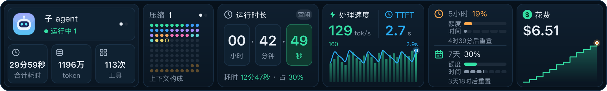
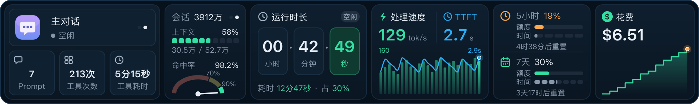

# session-stats

[](LICENSE)
[](.claude-plugin/plugin.json)
[](https://github.com/anthropics/claude-code)
[](https://www.typescriptlang.org/)

English | [简体中文](README.md)

A Claude Code plugin that shows statistics for the current session above the prompt
input: context and cache hit rate, output speed and TTFT, runtime, 5-hour and 7-day
rate limits, and cost. The desktop app shows a graphical panel; the terminal shows a
few lines of text. The interface text is in Chinese.



## What it shows

### Desktop

The panel has six cards. The first two cards have two pages each and turn pages
together every 20 seconds. The image below shows the second page:



| Card | Content |
| --- | --- |
| Sub-agents (`子 agent`) / Main conversation (`主对话`) | Page 1: number of running sub-agents; total time, tokens, and tool calls across sub-agents. Page 2: whether the main conversation is running; prompt count, tool call count, and tool time |
| Context / Session (`会话`) | Page 1: compaction count (`压缩`) and a dot grid of context composition. Page 2: session tokens, context usage, and a cache hit rate gauge |
| Runtime (`运行时长`) | Session runtime in hours, minutes, and seconds, marked LIVE while the main conversation runs; work time and its share of the runtime |
| Speed (`处理速度`) / TTFT | Average output speed and average TTFT; speed bars and a TTFT line for the last 24 requests |
| Rate limits (`5小时` / `7天`) | Quota used and time elapsed in the 5-hour and 7-day windows |
| Cost (`花费`) | Current cost and a step line of cost over time |

The chevron at the top center of the panel collapses and expands it: click ﹀ to
collapse the panel to a one-line summary, and click ︿ to restore it. The collapsed
state persists across sessions. The collapsed summary:

```
压缩 1 │ 会话 39.1M │ 命中率 98% │ 速度 129 tok/s │ TTFT 2.7s │ 花费 $6.51
```

### Terminal

The terminal shows up to four lines and wraps them when the window narrows. When the
session has no rate-limit readings of its own (for example, with API key billing, or
before the session has received a response), the rate-limit line is not shown.

```
压缩 1 │ 会话 3912万 │ 命中率 98.2% │ 速度 ≈129.1 tok/s │ TTFT ≈2.7s │ 花费 $6.51
时长 42分49秒 │ 耗时 12分47秒 │ Prompt 7 │ 工具 213次 · 5分15秒
5小时 19% · 4时39分后重置 │ 7天 30% · 3天18时后重置
运行中子 agent 1 │ 子 agent 合计 29分59秒 · 1196万 token · 工具 113次
```

To hide the band, use Claude Code's built-in `[-]` control (ctrl+x ctrl+a).

## Metrics

| Metric | Label | Definition |
| --- | --- | --- |
| Session tokens | `会话` | Sum of input (including cache reads and writes) and output across all requests from the main conversation and sub-agents |
| Hit rate | `命中率` | Cache-read tokens as a share of input tokens |
| Context usage | `上下文` | Matches `/context`; the denominator is the auto-compact window, which can be smaller than the model's context window |
| Speed | `速度` | Output tokens after the first token (including thinking), summed over requests, divided by the summed time between each request's first and last token |
| TTFT | `TTFT` | Time from sending a request to the start of the response, averaged over requests |
| Runtime | `时长` | From session start to the end of the main conversation's last turn; counts up to now while the main conversation runs and stops while it is idle |
| Work time | `耗时` | Sum of the durations of the main conversation's turns, including time spent waiting for permission prompts |
| Tool time | `工具` | Sum of the time from each tool call to its result, including time spent waiting for permission prompts; parallel calls are timed separately, so the total can exceed the work time |
| Rate limits | `5小时` / `7天` | Percentage used and reset time of the 5-hour and 7-day windows |
| Cost | `花费` | Matches `/cost` |

Calculation rules:

- Speed and TTFT count only main conversation requests. Sub-agents often use other
  models and run in parallel.
- Requests whose first and last tokens are less than 1 second apart count toward
  TTFT but not speed. The tokens of such requests often arrive in a single batch,
  which makes the computed speed unrepresentative.
- Requests that include thinking and whose TTFT is longer than the time between
  their first and last tokens also count toward TTFT only. When thinking is not
  displayed, output tokens include the thinking, and the start of the response
  occasionally arrives only after the thinking ends. The thinking time then falls
  inside TTFT, and dividing by the first-to-last-token time alone gives hundreds to
  thousands of tok/s. Requests without thinking are not subject to this rule.
- The hit rate gauge (`命中率`) has a linear scale: 0 at the left end, 100% at the
  right end, split into red, yellow, and green zones at 70% and 90%.
- For a resumed session, runtime starts from the session's first launch. If the
  session is already idle when the plugin loads, runtime runs up to the load time
  and is corrected when the next main conversation turn ends.
- Rate limits are per account. Each session writes its readings to
  `session-stats/rate-limits.json` in the Claude Code configuration directory
  (`~/.claude` by default, or `CLAUDE_CONFIG_DIR` when set), and each window shows
  the most recent reading across all sessions. A session uses this file only when
  it has rate-limit readings of its own: the file does not record the account, so
  accounts separated by `CLAUDE_CONFIG_DIR` each have their own file. A window with
  no reading, or one past its reset time, shows 0%.
- On the panel, a rate limit turns orange when the share of quota used exceeds the
  share of the window elapsed, and red when the quota is used up. The terminal
  colors by percentage used: orange from 80%, red at 100%.
- Session tokens, compactions, work time, tool calls, speed, TTFT, and sub-agent
  totals are counted by the plugin, starting when it loads in the current process
  or when the process switches to the current session. `/reload-plugins` keeps
  them; a resumed session (`--resume` or `/resume`) starts them from 0, and
  `/clear` resets them. Cost, prompt count, context usage, and rate limits are
  Claude Code's own readings and cover the whole session. The cost chart starts
  recording when the plugin loads.
- When a request fails or is interrupted before the response ends, Claude Code
  reports no usage for it, and its tokens are not counted in session tokens or the
  hit rate.

## Installation

Tested on Claude Code 2.1.309.

Install from GitHub:

```bash
claude plugin install session-stats --marketplace xumetide-dev/claude-session-stats
```

Install from within a session:

```
/plugin install session-stats --marketplace xumetide-dev/claude-session-stats
```

Install from a local directory, where the path is your clone of this repository:

```bash
claude plugin install session-stats --marketplace /path/to/claude-session-stats
```

The plugin takes effect in new sessions; in sessions already open, run
`/reload-plugins`. A plugin installed from a local directory reads that directory
directly, so after changing the code, also run `/reload-plugins`.

## Development

| Path | Content |
| --- | --- |
| `.claude-plugin/plugin.json` | Plugin manifest |
| `.claude-plugin/marketplace.json` | Marketplace file; its only entry points to the repository root |
| `hooks/register.tsx` | Entry point: reading refresh and counters |
| `hooks/band.tsx` | Band rendering, collapse, and expand |
| `hooks/panel/` | Desktop panel cards, charts, and icons |
| `hooks/format.ts` | Value formatting and terminal text lines |
| `hooks/summary.ts` | One-line summary shown when collapsed |
| `hooks/stats.ts` | Counter accumulation rules |
| `hooks/token-times.ts` | First and last token timing |
| `hooks/shared-limits.ts` | Sharing rate-limit readings across sessions |
| `types/index.d.ts` | Type contract for `$.state` |
| `tests/` | Tests |
| `scripts/readme-images.mts` | Renders the panel screenshots in this document from sample data |

Type checking requires a global TypeScript installation. From the repository root,
run the type check, tests, and manifest validation:

```bash
tsc -p . && claude plugin test . && claude plugin validate .
```

`tsconfig.json` extends `.claude-plugin/types/tsconfig.json`. That directory holds
type declarations that Claude Code generates when it loads the plugin, and it is not
committed. After cloning, run `claude --plugin-dir .` once to generate it, then run
the type check.

The screenshots in this document are rendered from sample data and require
`rsvg-convert` (on macOS, install it with `brew install librsvg`):

```bash
npx tsx scripts/readme-images.mts
```

## License

[Apache License 2.0](LICENSE)
